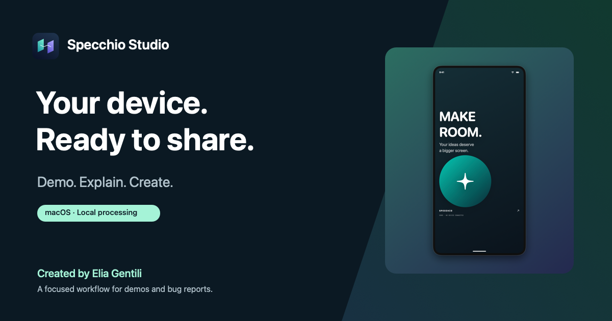

# Specchio Studio

**Your device. Ready to share.**

A native Mac project by [Elia Gentili](https://github.com/eliagentili), turning iPhone and iPad captures into product demos, creator assets and clearer bug reports.

[**Explore the preview →**](https://eliagentili.github.io/specchio-studio-site/) · [**Leggi in italiano →**](https://eliagentili.github.io/specchio-studio-site/it/)



## From a capture to something useful

- **Product demos:** record a source, then add framing, backgrounds and time trim to the exported video.
- **Clearer bug reports:** combine reproduction steps, annotated images, local OCR and Markdown/JSON in one folder. Unmasked originals are excluded by default.
- **Creator packages:** prepare portrait, square and landscape images or videos together, with a cover and file manifest.
- **Local tools:** compose, annotate, recognize text and review sensitive regions on the Mac, without an app account.


## An honest preview

The target is **macOS 14+ on Apple Silicon**, with an Italian app interface. The free **[experimental preview v1.3.1-preview.1](https://github.com/eliagentili/specchio-studio/releases/tag/v1.3.1-preview.1)** provides the app ZIP, corresponding source and checksums. Additional physical-device testing and review of provenance, name availability and distribution rights remain open. The app uses ad hoc signing and is not notarized; Gatekeeper assessment rejects this build. Read the release notes before downloading. This is an experimental release with the stated uncertainties, not completed rights clearance or a stable release.

Privacy masks require review. Video masks stay fixed throughout the clip; they do not track moving content. Original recordings, audio and manually written report fields are not automatically redacted. Recording and composed video export are separate steps.

## About this repository

This is the **public marketing website**. The [application source and experimental releases](https://github.com/eliagentili/specchio-studio) are hosted separately. It contains bilingual static pages, original artwork, styles and a small script for workflow tabs and a fictional-data illustration. The product visuals are generated by the real app canvas; they are clearly labeled as demo compositions.

The site has no dependencies, build service, analytics, cookies, third-party embeds or remote fonts. GitHub Pages serves the `main` branch from the repository root. Asset provenance is recorded in [assets/provenance.json](assets/provenance.json).

To preview this website locally:

```sh
python3 -m http.server 8080
```

Then open `http://localhost:8080/` or `/it/`. The website works without JavaScript; scripts enhance the workflow tabs and illustration.

## Feedback & creator

Have a workflow this could help with? [Open a project suggestion](https://github.com/eliagentili/specchio-studio-site/issues) or [explore Elia Gentili’s work](https://github.com/eliagentili). Please keep personal information and private recordings out of public issues.

Website source and original assets: **GPL-3.0-or-later**, see [LICENSE](LICENSE). This website license does not constitute clearance of rights for current or future app releases.
